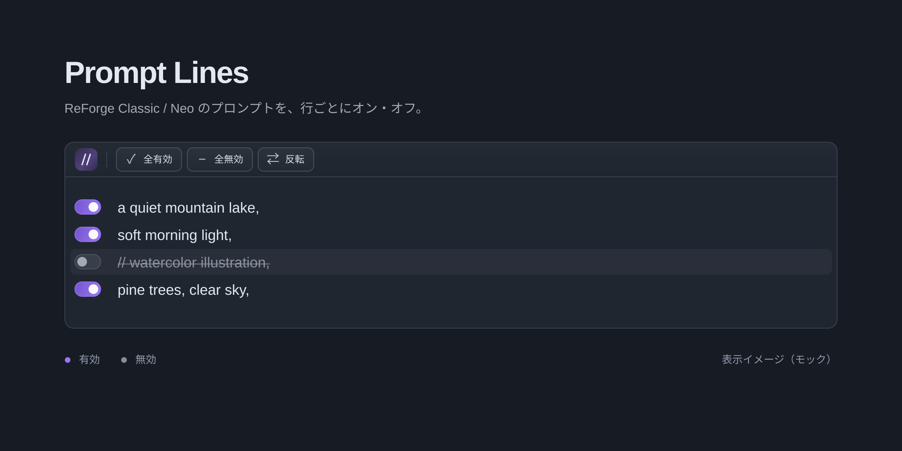
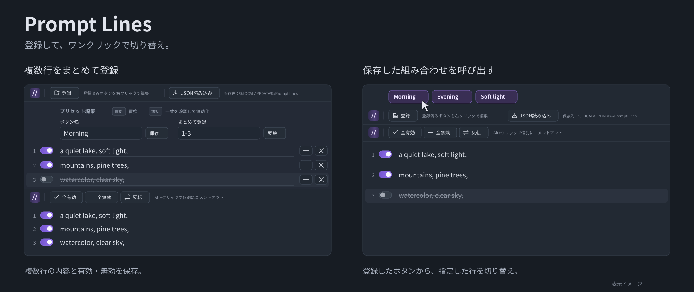
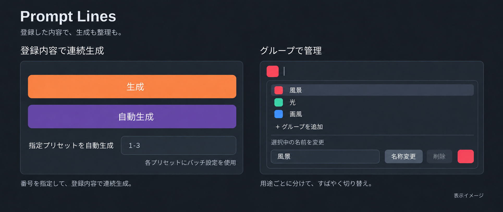

# Prompt Lines

ReForge Classic / Neo のプロンプトを行ごとにオン・オフできる拡張機能です。無効な行はグレーと打ち消し線で表示します。

Alt+クリックで、タグのまとまりを個別にオン・オフすることもできます。

複数行の内容と有効・無効をプリセットに保存し、登録したボタンから切り替えられます。

登録内容での連続生成と、グループごとのプリセット管理に対応しています。

